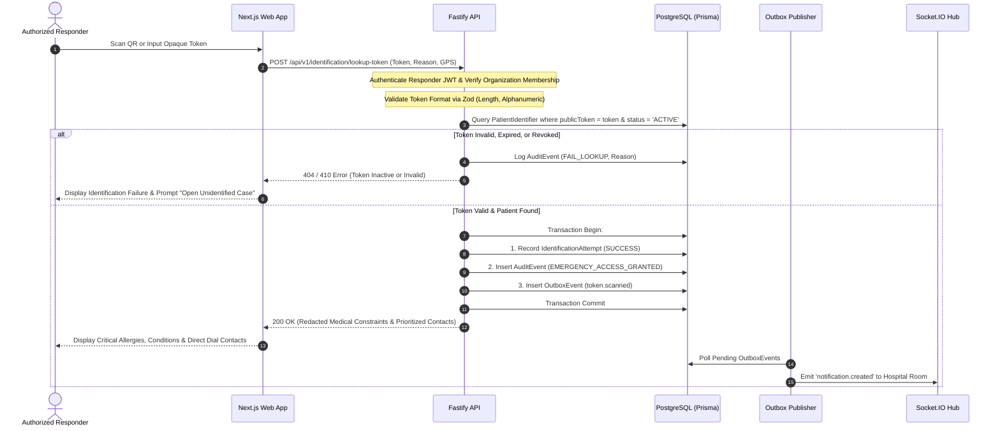

# MAXERY — System Architecture

**Document Identifier:** `DOC-02`  
**Status:** DRAFT FOR INITIAL REVIEW  
**Classification:** Technical Architecture  
**Architecture Style:** Modular Monolith with Separate Next.js Web Frontend & Fastify API Backend

---

## 1. Architectural Principles & Overview

MAXERY is architected as a **Modular Monolith** organized within an `npm` workspaces monorepo. This pattern was selected over microservices or serverless functions to guarantee:
1. **Strong Transactional Consistency:** Emergency workflows, patient records, and audit events require atomic database transactions across PostgreSQL tables.
2. **Operational Simplicity & High Availability:** A single, robust Fastify backend process is simpler to deploy, monitor, scale, and harden in high-stress environments than distributed microservice clusters.
3. **Decoupled User Interfaces:** The Next.js App Router powers the responsive web frontend without acting as an API layer. All data access, authentication, authorization, and business logic are enforced exclusively by the dedicated Fastify REST and Socket.IO API.

---

## 2. Monorepo Structure & System Boundaries

```mermaid
graph TD
    subgraph Client Tier
        W[Next.js Web Application\napps/web - Port 3000\nReact 19, JavaScript JSX, Modern CSS]
        M[Mobile Browser / Field Devices\nResponsive PWA Layout]
    end

    subgraph Network & Security Boundary
        LB[Reverse Proxy / TLS Termination\nNginx or Cloudflare - Port 443]
    end

    subgraph Application Tier
        API[Fastify Dedicated API Server\napps/api - Port 4000\nES Modules, Fastify v5]
        WS[Socket.IO Real-Time Server\nMounted on Fastify HTTP]
        JOB[Outbox Background Worker\nScheduled Poller / Event Dispatcher]
    end

    subgraph Shared Contract Tier
        SH[@maxery/shared\npackages/shared\nZod Schemas, Enums, Constants, API Contracts]
    end

    subgraph Data & Persistence Tier
        PG[(PostgreSQL 16 Authoritative DB\nRelational Storage, Prisma ORM)]
        RD[(Redis 7 Optional Cache & PubSub\nRate Limiting & Ephemeral State)]
    end

    W -->|HTTPS REST| LB
    M -->|HTTPS REST| LB
    W -.->|WSS WebSocket| LB
    LB -->|Internal Proxy| API
    LB -->|WebSocket Upgrade| WS
    API -->|Prisma Client| PG
    API -->|Validation| SH
    W -->|Shared Schemas| SH
    JOB -->|Poll Outbox Table| PG
    JOB -->|Emit Authenticated Events| WS
    API -.->|Ephemeral Cache & Limits| RD
```

---

## 3. Component Responsibilities

### 3.1 Frontend (`apps/web`)
- **Technology:** Next.js (App Router), React, JavaScript (JSX only).
- **Styling:** Modern Vanilla CSS design system with strict tokens in `globals.css` (high-contrast, dark/light themes, accessible focus rings).
- **Role:** Pure client presentation, server-side rendering of static legal and informational pages, and client-side application views.
- **Constraints:**
  - Strictly **NO** Next.js API Routes (`src/app/api/...`) used as an internal backend.
  - Strictly **NO** direct database connections.
  - Interacts with Fastify API via standard `fetch` with Bearer tokens or secure HTTP cookies.

### 3.2 Backend Service (`apps/api`)
- **Technology:** Node.js (v20+ LTS), Fastify (v5), ES Modules (`type: "module"`).
- **Role:** Authoritative business logic engine, validation, authentication, rate limiting, and database access.
- **Modules (Modular Monolith):**
  - `auth`: User registration, credential verification, JWT issuance, session validation.
  - `organisations`: Institutional emergency services, hospitals, memberships.
  - `patients`: Core patient profile management, emergency notes, blood group.
  - `patient-identifiers`: Cryptographic opaque token generation, QR resolution, revocation.
  - `medical-information`: Source attribution, verification states, contraindications.
  - `emergency-contacts`: Prioritized contacts, communication attempt outcomes.
  - `identification`: Tiered identification logic, emergency access validation, audit logging.
  - `unidentified-cases`: Incident registration, physical description matching, case lifecycle.
  - `audit`: Append-only immutable logging of all sensitive access and modifications.
  - `privacy`: DPDPA statutory requests, consent records, data retention enforcement.
  - `realtime`: Socket.IO room management and authorization.

### 3.3 Shared Contract Library (`packages/shared`)
- **Technology:** Pure JavaScript ES Modules with Zod.
- **Role:** Single source of truth for runtime validation schemas, API contracts, domain enums, error structures, and event constants.
- **Benefit:** Both Fastify routes and Next.js form handlers import identical Zod schemas, guaranteeing 100% contract synchronization without code duplication.

### 3.4 Authoritative Persistence (`PostgreSQL 16` & `Prisma ORM`)
- **Role:** The sole authoritative, ACID-compliant source of truth.
- **Safety:** All critical state mutations (e.g., creating an unidentified case and appending a `CaseEvent` and writing an `OutboxEvent`) execute in a single database transaction.

### 3.5 Real-Time & Reliability Layer (`Socket.IO` & `Transactional Outbox`)
- **Role:** Provides low-latency, event-driven updates to dispatchers and hospital emergency desks.
- **Design Pattern:** The Transactional Outbox Pattern ensures zero message loss:
  1. Business entity updated in Postgres.
  2. Outbox event written in the same Postgres transaction.
  3. Background worker reads pending outbox events and pushes them to Socket.IO rooms.
  4. Outbox event marked `PUBLISHED`.

---

## 4. Trust Boundaries & Security Zones

```
+-----------------------------------------------------------------------------------+
| ZONE 1: PUBLIC / CITIZEN NETWORK                                                 |
| - Unauthenticated Browsers, Mobile Devices, Physical QR Scanners                  |
| - Threat Vector: Malicious requests, token scanning, brute-force enumeration     |
+-----------------------------------------------------------------------------------+
                                   | (HTTPS TLS 1.3)
+-----------------------------------------------------------------------------------+
| ZONE 2: DMZ / REVERSE PROXY                                                       |
| - Rate Limiting, DDoS Mitigation, TLS Termination, Security Headers               |
+-----------------------------------------------------------------------------------+
                                   | (Internal Network)
+-----------------------------------------------------------------------------------+
| ZONE 3: APPLICATION SERVER (FASTIFY RUNTIME)                                      |
| - JWT & Role-Based Access Control (RBAC)                                          |
| - Input Validation via Zod Schemas                                                |
| - Audit Logging Engine (Records all responder lookups)                            |
+-----------------------------------------------------------------------------------+
                                   | (Authenticated Internal Connection)
+-----------------------------------------------------------------------------------+
| ZONE 4: AUTHORITATIVE PERSISTENCE (POSTGRESQL & REDIS)                            |
| - Restricted VPC / Private Subnet, Encrypted at Rest (AES-256)                    |
| - Read/Write Access strictly isolated to Fastify database credentials             |
+-----------------------------------------------------------------------------------+
```

---

## 5. End-to-End Emergency Lookup Sequence



---

## 6. Failure Modes & Graceful Degradation

| Failure Mode | Impact | System Mitigation |
|---|---|---|
| **Redis Cache Failure** | Rate limiting / session caching degraded. | API falls back to in-memory Fastify rate limiting and direct database token verification. Database remains authoritative. |
| **Socket.IO Realtime Failure** | Live UI pushes to dispatchers cease. | Web clients fall back to periodic HTTP polling (every 10s) for active cases. Core emergency lookup is unaffected. |
| **Geolocation Unavailable** | Responder device blocks GPS. | API logs `latitude: null, longitude: null`, captures client IP, and proceeds with emergency lookup so life-saving care is never blocked. |
| **Database Connection Exhaustion** | API requests queue or timeout. | Fastify connection pool limits set to match PostgreSQL maximum connections, with health check returning 503 during degradation. |
