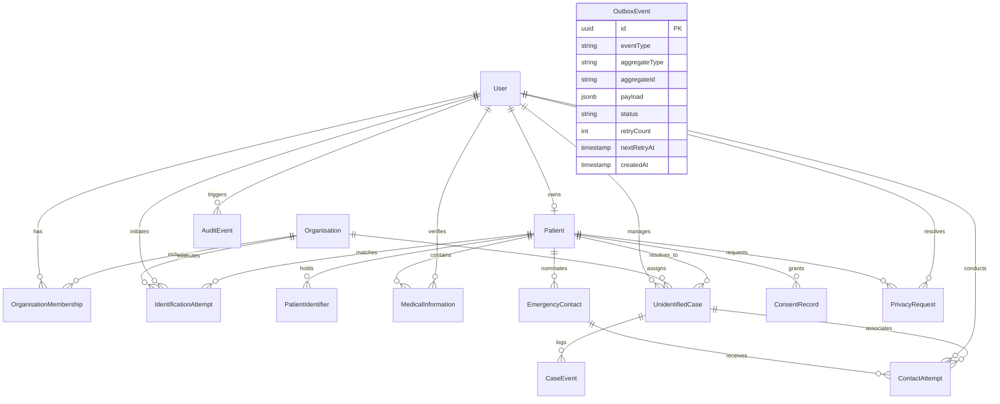

# MAXERY — Database Design Specification

**Document Identifier:** `DOC-05`  
**Status:** DRAFT FOR INITIAL REVIEW  
**Classification:** Authoritative Data Architecture  
**Database Engine:** PostgreSQL 16  
**ORM & Migration Tool:** Prisma ORM

---

## 1. Entity-Relationship (ER) Overview

---

## 2. Complete Entity Specifications

### 2.1 `User`
- **Purpose:** Stores authenticated platform users across all roles (Citizens, Responders, Dispatchers, Admins).
- **Primary Key:** `id` (UUID v4).
- **Fields:**
  - `email` (VARCHAR 255, UNIQUE, NOT NULL) — Login identifier.
  - `passwordHash` (TEXT, NOT NULL) — Scrypt/Argon2id cryptographic hash.
  - `fullName` (VARCHAR 120, NOT NULL) — Legal or operational name.
  - `role` (ENUM: `RESPONDER`, `ADMIN`, `PATIENT`, `DISPATCHER`, NOT NULL).
  - `phone` (VARCHAR 20, NULLABLE) — Contact phone number.
  - `badgeNumber` (VARCHAR 50, NULLABLE) — Government or institutional responder ID.
  - `isActive` (BOOLEAN, DEFAULT true) — Account operational status.
  - `lastLoginAt` (TIMESTAMPTZ, NULLABLE).
  - `createdAt`, `updatedAt` (TIMESTAMPTZ, NOT NULL).
- **Indexes:** `[email]`, `[role]`.
- **Data Sensitivity:** Confidential / PII.

### 2.2 `Organisation`
- **Purpose:** Represents verified emergency service providers, hospital networks, or dispatch agencies.
- **Primary Key:** `id` (UUID v4).
- **Fields:**
  - `name` (VARCHAR 255, NOT NULL) — e.g., "Bengaluru Central Emergency Medical Services".
  - `code` (VARCHAR 50, UNIQUE, NOT NULL) — Unique agency identifier.
  - `type` (ENUM: `HOSPITAL`, `AMBULANCE_SERVICE`, `LAW_ENFORCEMENT`, `FIRE_RESCUE`, `EMERGENCY_SERVICES`).
  - `contactEmail` (VARCHAR 255, NOT NULL), `contactPhone` (VARCHAR 20, NULLABLE).
  - `address` (TEXT, NULLABLE), `jurisdiction` (VARCHAR 100, NULLABLE).
  - `isVerified` (BOOLEAN, DEFAULT false), `isActive` (BOOLEAN, DEFAULT true).
- **Indexes:** `[code]`.

### 2.3 `OrganisationMembership`
- **Purpose:** Maps users to organizations with specific departmental roles.
- **Primary Key:** `id` (UUID v4).
- **Foreign Keys:** `userId` -> `User(id)`, `organisationId` -> `Organisation(id)`.
- **Unique Constraint:** `[userId, organisationId]`.

### 2.4 `Patient`
- **Purpose:** The core emergency medical profile for an individual.
- **Primary Key:** `id` (UUID v4).
- **Fields:**
  - `userId` (UUID, UNIQUE, NULLABLE) — Optional link to citizen user account.
  - `publicCode` (VARCHAR 64, UNIQUE, NOT NULL) — Internal non-sensitive reference.
  - `dateOfBirth` (DATE, NULLABLE), `bloodGroup` (VARCHAR 10, NULLABLE).
  - `gender` (VARCHAR 20, NULLABLE), `primaryLanguage` (VARCHAR 50, DEFAULT 'English').
  - `allergiesSummary` (TEXT, NULLABLE), `conditionsSummary` (TEXT, NULLABLE).
  - `medicationsSummary` (TEXT, NULLABLE), `isOrganDonor` (BOOLEAN, DEFAULT false).
  - `emergencyNotes` (TEXT, NULLABLE), `isActive` (BOOLEAN, DEFAULT true).
- **Indexes:** `[publicCode]`.
- **Data Sensitivity:** Highly Sensitive / Protected Health Information (PHI).

### 2.5 `PatientIdentifier`
- **Purpose:** Manages the cryptographically unguessable tokens associated with physical emergency artifacts.
- **Primary Key:** `id` (UUID v4).
- **Fields:**
  - `patientId` (UUID, NOT NULL) -> `Patient(id)` ON DELETE CASCADE.
  - `identifierType` (ENUM: `QR_CODE`, `PHONE_MEDICAL_ID`, `WRISTBAND`, `OTHER_DEVICE`).
  - `publicToken` (VARCHAR 128, UNIQUE, NOT NULL) — Opaque string (e.g., `MX-QR-7F89B2A4C1D0E3F5-DEMO`).
  - `tokenHash` (VARCHAR 64, UNIQUE, NULLABLE) — One-way SHA-256 hash for secure database verification.
  - `status` (ENUM: `ACTIVE`, `REVOKED`, `EXPIRED`, `SUSPENDED`, DEFAULT `ACTIVE`).
  - `expiresAt`, `revokedAt` (TIMESTAMPTZ, NULLABLE).
  - `revocationReason` (VARCHAR 255, NULLABLE).
- **Indexes:** `[publicToken]`, `[status]`.
- **Design Rule:** Opaque token contains ZERO patient identity or health data.

### 2.6 `MedicalInformation`
- **Purpose:** Granular, categorized medical constraints with mandatory provenance and verification tracking.
- **Primary Key:** `id` (UUID v4).
- **Fields:**
  - `patientId` (UUID, NOT NULL) -> `Patient(id)` ON DELETE CASCADE.
  - `category` (VARCHAR 100, NOT NULL) — e.g., `ALLERGY`, `MEDICATION`, `CHRONIC_CONDITION`.
  - `summary` (VARCHAR 255, NOT NULL) — Brief high-acuity summary (e.g., "Penicillin - Anaphylaxis").
  - `details` (TEXT, NULLABLE) — Expanded clinical notes.
  - `source` (ENUM: `SELF_REPORTED`, `FAMILY_REPORTED`, `PHYSICIAN_DOCUMENTED`, `DEVICE_MEDICAL_ID`).
  - `verificationStatus` (ENUM: `UNVERIFIED`, `PENDING_REVIEW`, `VERIFIED`, `DISPUTED`).
  - `verifiedByUserId` (UUID, NULLABLE) -> `User(id)` ON DELETE SET NULL.
  - `verifiedAt` (TIMESTAMPTZ, NULLABLE).
- **Indexes:** `[patientId]`, `[verificationStatus]`.

### 2.7 `EmergencyContact`
- **Purpose:** Priority-ordered trusted contacts nominated by the patient.
- **Primary Key:** `id` (UUID v4).
- **Fields:**
  - `patientId` (UUID, NOT NULL) -> `Patient(id)` ON DELETE CASCADE.
  - `fullName` (VARCHAR 120, NOT NULL), `relationship` (VARCHAR 60, NOT NULL).
  - `primaryPhone` (VARCHAR 20, NOT NULL), `alternatePhone` (VARCHAR 20, NULLABLE).
  - `priority` (ENUM: `PRIMARY`, `SECONDARY`, `TERTIARY`, DEFAULT `PRIMARY`).
  - `isVerified` (BOOLEAN, DEFAULT false), `consentStatus` (VARCHAR 50, DEFAULT 'OPTED_IN').
  - `notes` (TEXT, NULLABLE).
- **Indexes:** `[patientId]`, `[priority]`.

### 2.8 `IdentificationAttempt`
- **Purpose:** Immutable audit record of every scan or lookup initiated by a responder.
- **Primary Key:** `id` (UUID v4).
- **Fields:**
  - `responderUserId` (UUID, NOT NULL) -> `User(id)` ON DELETE RESTRICT.
  - `organisationId` (UUID, NULLABLE) -> `Organisation(id)`.
  - `identifierType` (ENUM: `QR_CODE`, `PHONE_MEDICAL_ID`, etc.).
  - `identifierToken` (VARCHAR 128, NOT NULL).
  - `matchedPatientId` (UUID, NULLABLE) -> `Patient(id)`.
  - `status` (ENUM: `SUCCESS_MATCHED`, `FAILED_INVALID_TOKEN`, `FAILED_REVOKED`, `FAILED_EXPIRED`, `FAILED_UNAUTHORIZED`).
  - `failureReason` (VARCHAR 255, NULLABLE), `accessReason` (VARCHAR 255, NULLABLE).
  - `latitude`, `longitude` (DOUBLE PRECISION, NULLABLE) — GPS location of scan.
  - `createdAt` (TIMESTAMPTZ, DEFAULT now()).
- **Indexes:** `[responderUserId]`, `[matchedPatientId]`, `[identifierToken]`, `[createdAt]`.

### 2.9 `UnidentifiedCase`
- **Purpose:** Active case file for an incapacitated individual whose identity cannot be established.
- **Primary Key:** `id` (UUID v4).
- **Fields:**
  - `caseNumber` (VARCHAR 32, UNIQUE, NOT NULL) — e.g., `CASE-2026-0001`.
  - `status` (ENUM: `OPEN_UNIDENTIFIED`, `INVESTIGATING`, `PROVISIONALLY_IDENTIFIED`, `RESOLVED_IDENTIFIED`, `CLOSED_UNRESOLVED`).
  - `urgency` (ENUM: `CRITICAL`, `URGENT`, `STABLE`, `UNKNOWN`).
  - `responderUserId` (UUID, NOT NULL) -> `User(id)`.
  - `organisationId` (UUID, NULLABLE) -> `Organisation(id)`.
  - `patientId` (UUID, NULLABLE) -> `Patient(id)` — Linked upon positive identification.
  - `estimatedAge` (VARCHAR 50, NULLABLE), `estimatedGender` (VARCHAR 30, NULLABLE).
  - `physicalDescription` (TEXT, NULLABLE), `clothingDescription` (TEXT, NULLABLE).
  - `distinguishingFeatures` (TEXT, NULLABLE).
  - `locationFound` (VARCHAR 255, NOT NULL), `hospitalName` (VARCHAR 255, NULLABLE).
  - `notes` (TEXT, NULLABLE), `resolvedAt` (TIMESTAMPTZ, NULLABLE).
- **Indexes:** `[caseNumber]`, `[status]`, `[responderUserId]`.

### 2.10 `CaseEvent`
- **Purpose:** Append-only chronological timeline of events for an unidentified patient case.
- **Primary Key:** `id` (UUID v4).
- **Fields:**
  - `caseId` (UUID, NOT NULL) -> `UnidentifiedCase(id)` ON DELETE CASCADE.
  - `userId` (UUID, NULLABLE) -> `User(id)`.
  - `eventType` (VARCHAR 50, NOT NULL) — e.g., `CASE_OPENED`, `TRIAGE_UPDATED`, `CONTACT_ATTEMPTED`.
  - `description` (TEXT, NOT NULL), `metadata` (JSONB, NULLABLE).
  - `createdAt` (TIMESTAMPTZ, DEFAULT now()).
- **Indexes:** `[caseId]`, `[createdAt]`.

### 2.11 `ContactAttempt`
- **Purpose:** Records responder communication attempts with trusted emergency contacts.
- **Primary Key:** `id` (UUID v4).
- **Fields:**
  - `caseId` (UUID, NULLABLE) -> `UnidentifiedCase(id)`.
  - `emergencyContactId` (UUID, NOT NULL) -> `EmergencyContact(id)` ON DELETE CASCADE.
  - `responderUserId` (UUID, NOT NULL) -> `User(id)`.
  - `method` (VARCHAR 50, DEFAULT 'PHONE_CALL').
  - `outcome` (ENUM: `CONNECTED_AWARE`, `NO_ANSWER`, `VOICEMAIL_LEFT`, `WRONG_NUMBER`, `BUSY`, `CALL_FAILED`).
  - `notes` (TEXT, NULLABLE), `attemptTimestamp` (TIMESTAMPTZ, DEFAULT now()).

### 2.12 `ConsentRecord`
- **Purpose:** Verifiable statutory consent logging under Section 6 of DPDPA 2023.
- **Primary Key:** `id` (UUID v4).
- **Fields:**
  - `patientId` (UUID, NOT NULL) -> `Patient(id)` ON DELETE CASCADE.
  - `consentType` (VARCHAR 100, NOT NULL) — e.g., `EMERGENCY_DATA_DISCLOSURE`.
  - `granted` (BOOLEAN, DEFAULT true), `purpose` (TEXT, NOT NULL).
  - `recordedByUserId` (UUID, NULLABLE), `validUntil` (TIMESTAMPTZ, NULLABLE).
  - `ipAddress` (VARCHAR 45, NULLABLE), `createdAt` (TIMESTAMPTZ, DEFAULT now()).

### 2.13 `AuditEvent`
- **Purpose:** Immutable, tamper-evident security audit trail for all sensitive operations.
- **Primary Key:** `id` (UUID v4).
- **Fields:**
  - `userId` (UUID, NULLABLE) -> `User(id)` ON DELETE SET NULL.
  - `organisationId` (UUID, NULLABLE).
  - `action` (VARCHAR 100, NOT NULL) — e.g., `QR_LOOKUP_SUCCESS`, `PATIENT_RECORD_VIEW`.
  - `entityType` (VARCHAR 50, NOT NULL), `entityId` (VARCHAR 64, NULLABLE).
  - `ipAddress` (VARCHAR 45, NULLABLE), `userAgent` (TEXT, NULLABLE).
  - `metadata` (JSONB, NULLABLE) — Sanitized contextual metadata.
  - `createdAt` (TIMESTAMPTZ, DEFAULT now()).
- **Indexes:** `[userId]`, `[action]`, `[entityType, entityId]`, `[createdAt]`.

### 2.14 `PrivacyRequest`
- **Purpose:** Tracks citizen statutory data subject requests (SAR, Erasure, Rectification).
- **Primary Key:** `id` (UUID v4).
- **Fields:**
  - `userId` (UUID, NULLABLE), `patientId` (UUID, NULLABLE).
  - `requestType` (ENUM: `ACCESS_EXPORT`, `RECTIFICATION`, `ERASURE_FORGOTTEN`, `RESTRICTION`).
  - `status` (ENUM: `PENDING`, `IN_REVIEW`, `COMPLETED`, `REJECTED`).
  - `reason` (TEXT, NOT NULL), `resolutionNotes` (TEXT, NULLABLE).
  - `resolvedByUserId` (UUID, NULLABLE) -> `User(id)`.
  - `requestedAt`, `resolvedAt` (TIMESTAMPTZ).

### 2.15 `OutboxEvent`
- **Purpose:** Implements the Transactional Outbox Pattern to guarantee at-least-once event delivery to WebSockets and message workers.
- **Primary Key:** `id` (UUID v4).
- **Fields:**
  - `eventType` (VARCHAR 100, NOT NULL) — e.g., `case.created`, `case.status_updated`.
  - `aggregateType` (VARCHAR 50, NOT NULL) — e.g., `UnidentifiedCase`.
  - `aggregateId` (VARCHAR 64, NOT NULL).
  - `payload` (JSONB, NOT NULL) — Minimal non-sensitive event payload.
  - `status` (ENUM: `PENDING`, `PROCESSING`, `PUBLISHED`, `FAILED`, DEFAULT `PENDING`).
  - `retryCount` (INT, DEFAULT 0), `nextRetryAt` (TIMESTAMPTZ, DEFAULT now()).
  - `error` (TEXT, NULLABLE), `createdAt`, `processedAt` (TIMESTAMPTZ).
- **Indexes:** `[status, nextRetryAt]`, `[aggregateType, aggregateId]`.

---

## 3. Transaction Boundaries & Data Integrity

1. **Emergency Identifier Lookup:**
   - Evaluated in a single transaction: reads `PatientIdentifier` and `Patient`, creates `IdentificationAttempt`, appends `AuditEvent`, and conditionally inserts `OutboxEvent`.
2. **Unidentified Case Creation:**
   - Evaluated in a single transaction: inserts `UnidentifiedCase`, creates initial `CaseEvent`, and inserts `OutboxEvent(case.created)`.
3. **Emergency Contact Outreach:**
   - Evaluated in a single transaction: inserts `ContactAttempt`, appends `CaseEvent` (if linked to case), and inserts `OutboxEvent(contact.attempt_updated)`.
