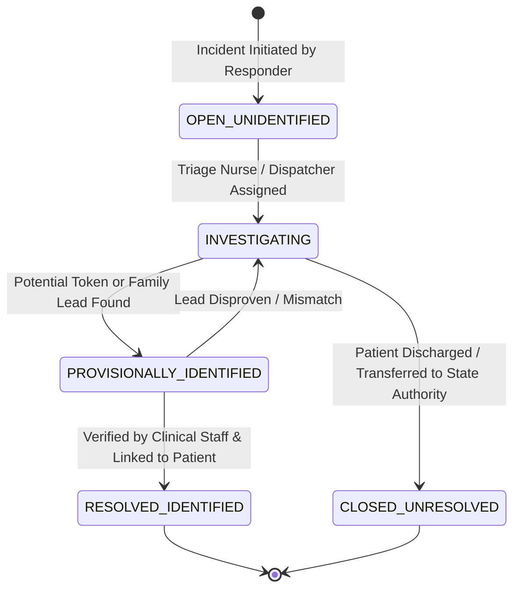

# MAXERY — Emergency Case Workflows

**Document Identifier:** `DOC-09`  
**Status:** DRAFT FOR INITIAL REVIEW  
**Classification:** Operational Field & Triage Workflows  
**Module:** Unidentified Case Management

---

## 1. Case Lifecycle State Machine

---

## 2. State Definitions & Operational Rules

### 2.1 `OPEN_UNIDENTIFIED`
- **Trigger:** Field responder creates case via `POST /api/v1/cases` when an incapacitated individual lacks verifiable identification.
- **Data Captured:** Location found, estimated age/gender, physical attributes, clothing, receiving hospital, initial triage acuity (`CRITICAL`, `URGENT`, `STABLE`).
- **Automated Actions:**
  - Case assigned human-readable sequential number (`CASE-2026-0001`).
  - Initial `CaseEvent(CASE_OPENED)` logged.
  - Transactional `OutboxEvent(case.created)` emitted to hospital receiving desks.

### 2.2 `INVESTIGATING`
- **Trigger:** Receiving hospital emergency desk acknowledges intake and begins secondary investigation (reviewing personal belongings, cross-referencing transit incident reports).
- **Actions:**
  - Responders and triage staff append ongoing notes and updates via `POST /api/v1/cases/:id/events`.
  - Triage updates, bed allocations, or department transfers are recorded in real time.

### 2.3 `PROVISIONALLY_IDENTIFIED`
- **Trigger:** A matching lead is identified (e.g., family member calls hospital matching clothing description, or a registered MAXERY patient profile is found matching physical traits).
- **Clinical Safety Rule:** Provisional status does **NOT** authorize clinical medication changes until positive verification is completed by medical staff.

### 2.4 `RESOLVED_IDENTIFIED`
- **Trigger:** Verified confirmation by hospital medical staff (e.g., patient regains consciousness, next of kin confirms identity with government ID, or positive medical record match).
- **Actions:**
  - Authorized responder links the `case.patientId` to the confirmed `Patient.id`.
  - Case status transitioned to `RESOLVED_IDENTIFIED`.
  - Audit event logged recording who authorized the identification match.

### 2.5 `CLOSED_UNRESOLVED`
- **Trigger:** Patient transferred to state psychiatric or long-term care facility, or discharged under local law enforcement custody without a MAXERY profile match.
- **Actions:** Case closed with comprehensive audit notes, maintaining the chain of custody for legal and forensic documentation.
