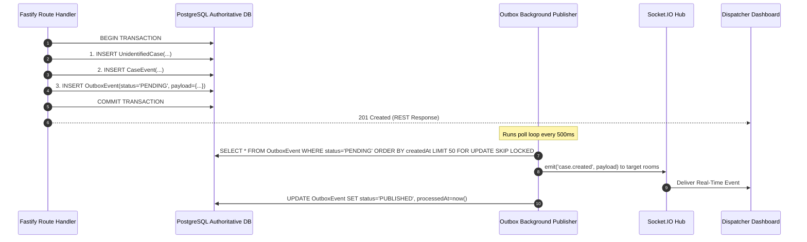

# MAXERY — Real-Time Architecture & Event Contracts

**Document Identifier:** `DOC-11`  
**Status:** DRAFT FOR INITIAL REVIEW  
**Classification:** Real-Time Infrastructure & Reliability  
**Engine:** Socket.IO v4 mounted on Fastify HTTP Listener

---

## 1. Real-Time Principles

1. **Minimal, Opaque Payloads:** Real-time event broadcasts contain only opaque resource identifiers and status markers (e.g., `{ caseId: "uuid", status: "INVESTIGATING" }`). Events NEVER broadcast raw patient names, medical conditions, or phone numbers over WebSockets.
2. **Authorized Room Gating:** Clients cannot join arbitrary rooms. The server strictly validates user roles and organization memberships before admitting a socket to any room.
3. **Guaranteed Delivery via Transactional Outbox:** Real-time messages are not broadcast directly from HTTP handlers. Instead, state changes and outbox records are committed together in PostgreSQL, and an outbox worker dispatches them reliably.
4. **Resilient Reconnection:** If a WebSocket connection drops (e.g., ambulance passes through a tunnel), clients reconnect automatically, authenticate, and fetch current state via authorized REST endpoints.

---

## 2. Event Catalog & Payloads

| Event Name | Room Scope | Triggering Action | Payload Structure |
|---|---|---|---|
| `case.created` | `hospital:{orgId}`<br>`dispatch:{regionId}` | New unidentified case opened by field responder. | `{"caseId": "uuid", "caseNumber": "CASE-2026-0001", "urgency": "URGENT", "hospitalName": "Bowring Hospital"}` |
| `case.status_updated` | `case:{caseId}`<br>`hospital:{orgId}` | Case status transitioned (e.g., to `RESOLVED_IDENTIFIED`). | `{"caseId": "uuid", "status": "RESOLVED_IDENTIFIED", "resolvedAt": "2026-10-22T21:45:00Z"}` |
| `case.assigned` | `case:{caseId}` | Case assigned to specific responder or triage team. | `{"caseId": "uuid", "assignedUserId": "uuid"}` |
| `contact.attempt_updated` | `case:{caseId}` | Responder logs phone outreach outcome. | `{"caseId": "uuid", "contactId": "uuid", "outcome": "CONNECTED_AWARE"}` |
| `notification.created` | `user:{userId}` | Critical alert for specific user (e.g., token scan alert). | `{"notificationId": "uuid", "type": "SECURITY_SCAN_ALERT", "createdAt": "..."}` |

---

## 3. Server-Side Room Authorization Flow

```javascript
// Server-side Socket.IO room join handler
socket.on('case:join', async ({ caseId }) => {
  const user = socket.data.user;
  
  // Verify user is active responder, dispatcher, or admin
  if (!['RESPONDER', 'DISPATCHER', 'ADMIN'].includes(user.role)) {
    return socket.emit('error', { message: 'Unauthorized room access' });
  }

  // Verify user belongs to the assigned organization or owns the case
  const hasAccess = await verifyCaseAccess(user.id, caseId);
  if (!hasAccess) {
    return socket.emit('error', { message: 'Forbidden: Case access restricted' });
  }

  socket.join(`case:${caseId}`);
  socket.emit('joined', { room: `case:${caseId}` });
});
```

---

## 4. Transactional Outbox Engine



### 4.1 Retry & Dead-Letter Handling
- If the Socket.IO server encounters an internal error, the outbox record is incremented (`retryCount += 1`) and scheduled for exponential backoff (`nextRetryAt = now() + 2^retryCount seconds`).
- After 5 consecutive failures, the event transitions to `FAILED` status, triggering a system alert for administrative inspection.
