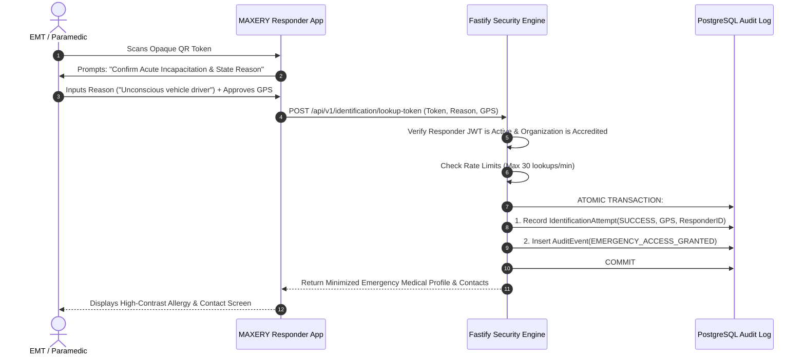

# MAXERY — Emergency Access Policy & Break-Glass Protocol

**Document Identifier:** `DOC-18`  
**Status:** DRAFT FOR INITIAL REVIEW  
**Classification:** Operational Security & Clinical Governance  
**Scope:** Field & Hospital Emergency Lookup Authorization

---

## 1. Principles of Emergency Access

In acute clinical medicine, immediate access to an incapacitated patient's drug allergies (e.g., penicillin anaphylaxis) or anticoagulant status can mean the difference between life and death. However, unconstrained emergency access creates acute privacy risks.

MAXERY resolves this tension through a **Restricted Emergency Access Protocol**:
1. **No Master Administrative Bypass:** There is no "super-user" switch that exposes all patient records in cleartext without auditing.
2. **One Token, One Record:** Responders can only access data associated with the specific, verified physical token in their immediate physical presence.
3. **Mandatory Identity & Location Attestation:** The responder's identity, authenticated role, timestamp, operational reason, and GPS location are atomically recorded before data is returned.
4. **Data Redaction:** The emergency payload returned is strictly minimized to life-critical constraints (allergies, medications, blood group, contacts). Full account history, billing data, and non-emergency notes are excluded.

---

## 2. The Emergency Access Protocol ("Break-Glass")

---

## 3. Post-Incident Review & Compliance Auditing

1. **Patient Notification:** Following an emergency lookup, an automated security notification is queued for delivery to the patient's registered email or primary contact, informing them that their emergency profile was accessed by an accredited responder.
2. **Monthly Institutional Audit:** Every accredited hospital and EMS agency must conduct monthly random audits of at least 10% of all emergency lookups performed by their personnel, verifying that each lookup corresponded to an active emergency incident log or run-sheet.
3. **Penalties for Misuse:** Any responder discovered accessing records outside an active emergency incident faces immediate credential revocation, termination of institutional membership, and referral to law enforcement under Section 43/66 of the Information Technology Act, 2000.
