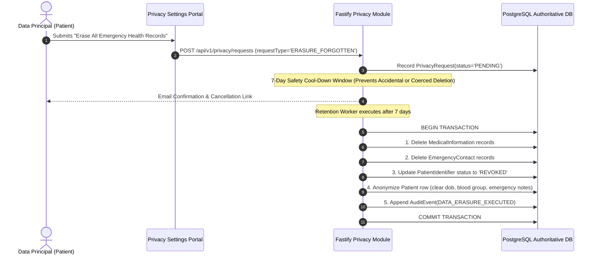

# MAXERY — Data Retention & Deletion Policy

**Document Identifier:** `DOC-20`  
**Status:** DRAFT FOR INITIAL REVIEW  
**Classification:** Data Lifecycle & Statutory Compliance  
**Alignment:** Section 8(7), DPDPA 2023 & CERT-In Cybersecurity Directives

---

## 1. Statutory Retention Principles (DPDPA 2023)

Under Section 8(7) of the Digital Personal Data Protection Act, 2023, a Data Fiduciary must erase personal data upon:
1. The Data Principal withdrawing their consent, or
2. It being reasonable to assume that the specified purpose for which the personal data was collected is no longer being served,
whichever is earlier, unless retention is necessary for compliance with any law for the time being in force.

---

## 2. Data Entity Retention Schedule

| Data Category / Entity | Active Retention Period | Post-Closure / Deletion Action | Statutory Mandate / Exception |
|---|---|---|---|
| **Patient Profile & Medical Data** | Active Account Lifespan | Hard deleted from PostgreSQL within 30 days of verified erasure request. | DPDPA Section 8(7) / Consent Withdrawal. |
| **Emergency Contact Details** | Active Account Lifespan | Hard deleted immediately upon patient profile deletion or contact replacement. | Data Minimization Principle. |
| **Physical Identifier Tokens** | Active until revoked or replaced | Status set to `REVOKED`; tokens retained as cryptographic tombstones to prevent reuse. | Security integrity (prevents token reassignment). |
| **Unidentified Case Files** | Active until case closure + 7 years | Archived to encrypted cold storage; accessible only to institutional compliance officers. | Clinical incident records & medico-legal documentation. |
| **Security Audit Logs (`AuditEvent`)** | Minimum 180 days active; 5 years archived | Cryptographically hashed and moved to append-only cold storage (WORM). | Mandatory compliance with CERT-In Cybersecurity Directives (2022). |
| **Outbox Events (`OutboxEvent`)** | 7 days post-publication | Automated daily purger removes rows where `status = 'PUBLISHED'`. | Database performance maintenance. |

---

## 3. Citizen Erasure & Right to Be Forgotten Workflow

