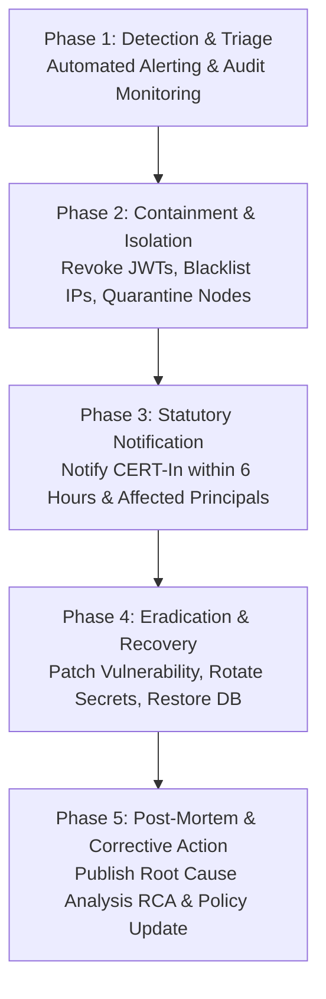

# MAXERY — Security Incident & Breach Response Plan

**Document Identifier:** `DOC-21`  
**Status:** DRAFT FOR INITIAL REVIEW  
**Classification:** Incident Management & Statutory Breach Reporting  
**Statutory Basis:** CERT-In Cybersecurity Directives (Directions under Section 70B(6), IT Act, 2000)

---

## 1. Statutory CERT-In Reporting Mandate (6-Hour Window)

Under the directions issued by the Indian Computer Emergency Response Team (CERT-In), cybersecurity incidents of severe nature (including unauthorized access to systems, data breaches, database compromise, or rogue responder access) **MUST BE REPORTED TO CERT-In WITHIN SIX (6) HOURS** of notice or becoming aware of the incident.

- **Incident Reporting Portal:** https://www.cert-in.org.in
- **Reporting Email:** `incident@cert-in.org.in`
- **Emergency Incident Hotline:** 1800-11-4949

---

## 2. Severity Classification Matrix

| Level | Classification | Trigger Criteria | Response SLA |
|---|---|---|---|
| **SEV-1** | **Critical Breach / System Compromise** | Confirmed data breach exposing patient medical constraints, private encryption keys leaked, or total system outage during live operations. | Initial containment within 30 min; CERT-In notified within 6 hours. |
| **SEV-2** | **High / Unauthorized Responder Access** | Compromised responder account scanning tokens maliciously, rogue insider access detected, or partial database corruption. | Containment within 2 hours; internal investigation initiated immediately. |
| **SEV-3** | **Medium / Operational Degradation** | Distributed denial-of-service (DDoS) mitigated by rate limiters, transient Socket.IO failure, or non-critical worker backlog. | Resolution within 12 hours. |
| **SEV-4** | **Low / Informational** | Port scanning attempts, isolated failed login threshold triggers, minor UI bugs. | Standard sprint maintenance. |

---

## 3. Incident Response Protocol & Phases

### 3.1 Phase 1: Detection & Triage
- Automated detection via Fastify error handlers, rate-limit thresholds, and audit anomaly analyzers.
- Incident Commander appointed immediately upon SEV-1 or SEV-2 declaration.

### 3.2 Phase 2: Containment & Isolation
- If a responder account is compromised: Fastify JWT blacklist engaged immediately via Redis; user status set to `isActive = false` in PostgreSQL.
- If an opaque token is leaked publicly: `PatientIdentifier` marked `REVOKED`, immediately blocking further resolutions.
- Database access credentials rotated across all environments.

### 3.3 Phase 3: Statutory Notification & Communications
- CERT-In notification dispatched via formal incident reporting template within 6 hours.
- If personal data of Data Principals is breached, notifications dispatched to the Data Protection Board of India and affected individuals in accordance with Section 8(6) of DPDPA 2023.

### 3.4 Phase 4: Eradication, Recovery & Post-Mortem
- Full root-cause analysis (RCA) completed within 72 hours of incident closure.
- Preventative controls automated into CI/CD pipelines.
