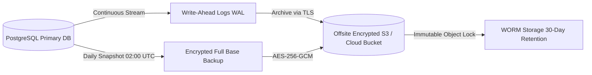

# MAXERY — Backup & Disaster Recovery Plan

**Document Identifier:** `DOC-27`  
**Status:** DRAFT FOR INITIAL REVIEW  
**Classification:** Business Continuity & Disaster Recovery  
**Target RPO / RTO:** RPO < 5 Minutes | RTO < 30 Minutes

---

## 1. Objectives & Recovery Metrics

| Metric | Target Standard | Strategy / Tooling |
|---|---|---|
| **Recovery Point Objective (RPO)** | **< 5 Minutes** | Continuous PostgreSQL Write-Ahead Log (WAL) archiving to off-site encrypted object storage. |
| **Recovery Time Objective (RTO)** | **< 30 Minutes** | Automated container redeployment from versioned container registries with pre-tested automated restore scripts. |

---

## 2. Backup Architecture & Encryption



### 2.1 Encryption & Tamper-Resistance
- All base backups and WAL segments are encrypted using AES-256-GCM before exiting the database host.
- Cloud storage buckets enforce **WORM (Write Once, Read Many) Object Locking**, preventing ransomware from encrypting or deleting historical backups.

---

## 3. Disaster Recovery Testing & Restore Drills

1. **Automated Monthly Restore Drill:** An automated CI job pulls the latest encrypted base backup and WAL archives into an isolated sandbox environment, performs a Point-in-Time Recovery (PITR), runs Prisma migration checks, and verifies that synthetic test patient records match the expected cryptographic checksums.
2. **Documented Runbook:**
   ```bash
   # Emergency database restore command
   pg_restore --clean --if-exists -U maxery_user -d maxery_dev backup_latest.dump
   ```
